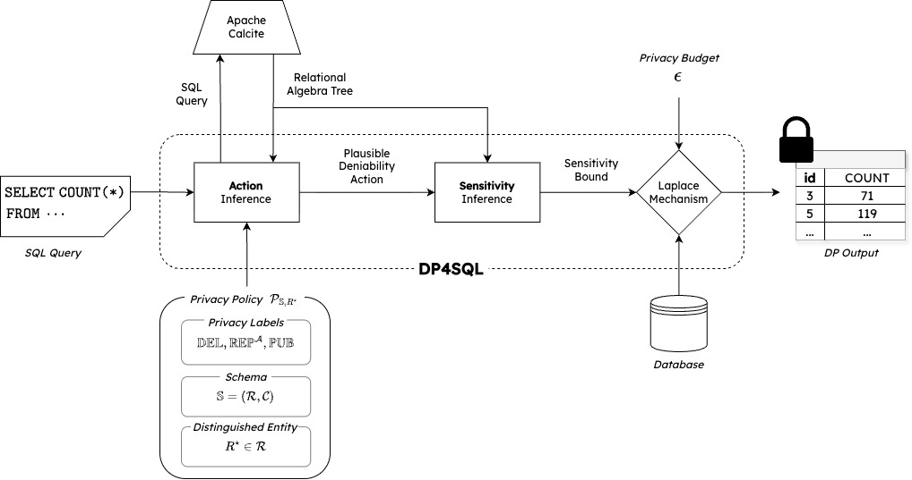

# DP4SQL

DP4SQL is a differentially private SQL system that allows data curators to better customize the plausible deniability requirements for their relational databases. The user provides a SQL query, a privacy policy, and a privacy budget and DP4SQL computes a sufficient amount of noise that must be added to the query answer in order to satisfy $\epsilon$-differential privacy.



## Requirements

Before starting, ensure you have the following installed:

- [sbt](https://www.scala-sbt.org/) (Simple Build Tool for Scala)
    - For building the artifact and generating sensitivity and noise values.
- [Jupyter Notebook](https://jupyter.org/install#jupyter-notebook)
    - For reproducing figures with the generated results.
- Python Packages: numpy, matplotlib

### Docker (Optional)

Alternatively, you may create a container from our Docker image which comes with all requirements preconfigured.

```
docker pull casciand/dp4sql
docker run -it casciand/dp4sql bash
```
*Note: The image may not contain the latest updates.*

## Usage

New schemas, queries, and privacy policies can be added in the `src/main/resources` directory as .yaml files. Examples can be found at `src/main/resources/university` and `src/main/resources/tpch`.

### Schemas

A schema is a list of relations with the following structure:

```
relations:
  - "name": "<relation_name>"
    "identifier": ["<ident1>", "<ident2>", ...]
    "attributes":
      - "name": "<attribute_name>"
        "datatype":
          "name": "string" | "int" | "decimal" | "categorical" | "datetime" | "foreign key"
```

### Privacy Policies

A privacy policy is a list of privacy labels for each relation and maximum frequencies for each attribute:

```
relations:
  - "name": "<relation_name>"
    "global_entity": true | false
    "privacy_policy":
      "name": "DEL" | "REP" | "PUB"
    "attributes":
      - "name": "<attribute_name>"
        "max_frequency": <max_frequency>
```

### Configuration

The list of queries is put in a configuration file that links together the schema and privacy policies:

```
schema_path: "<schema_path>"

privacy_models:
  <policy_name>: "<policy_path>"

queries:
  <query_name>: "<sql_query>"
```

### Command Line Interface

This artifact includes a CLI that supports the following operations for a given schema, set of privacy policies, and set of queries:

1. Viewing the schema's relations.
2. Deriving the relational algebra tree of a query.
3. Computing the sensitivity of a query.
4. Sampling noise to be added to a query answer.

To start, run

```
sbt "runMain CustomDP4SQL.Interface.CommandLineInterface <path_to_config>"
```

replacing ``<path_to_config>`` with the path to your configuration file.

## Citation

```
@inproceedings{dp4sql,
    author = {Cascio, Andrew and Tong, KinChin and Kifer, Daniel and Ding, Zeyu and Zhang, Danfeng},
    title = {DP4SQL: Differentially Private SQL with Flexible Privacy Policies},
    year = {2026},
    isbn = {9798400728716},
    publisher = {Association for Computing Machinery},
    address = {New York, NY, USA},
    url = {https://doi.org/10.1145/3830454.3832666},
    doi = {10.1145/3830454.3832666},
    booktitle = {Proceedings of the 2026 ACM SIGSAC Conference on Computer and Communications Security},
    pages = {5956–5970},
    numpages = {15},
    location = {The Hague, Netherlands},
    series = {CCS '26}
}
```